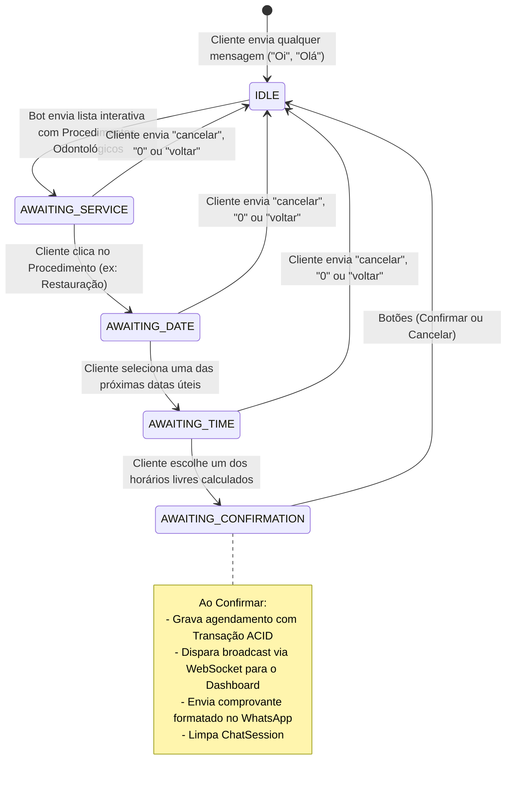

# 🦷 AutoScheduler — Sistema Inteligente de Agendamentos em Tempo Real com WhatsApp Cloud API (Meta)

<div align="center">

[](https://github.com/GabrielLopesz9135/whatsapp_scheduler/actions/workflows/ci.yml)


<br />

**Plataforma Full-Stack corporativa para automação de atendimentos e agendamentos via WhatsApp oficial (Meta Graph API) com sincronização bidirecional em tempo real (WebSockets) e Dashboard Administrativo reativo.**

[Visão Geral](#-visão-geral-do-projeto) •
[Arquitetura](#-arquitetura-do-sistema) •
[Engenharia e Diferenciais](#-destaques-de-engenharia-de-software) •
[Fluxo da Máquina de Estados](#-máquina-de-estados-do-whatsapp-fsm) •
[Stack Tecnológica](#-stack-tecnológica-completa) •
[Modelagem de Dados](#-modelagem-de-dados-mongodb) •
[Endpoints da API](#-especificação-da-api-rest) •
[Como Executar](#-guia-de-instalação-e-execução)

---

</div>

## 📌 Visão Geral do Projeto

O **AutoScheduler** foi concebido para resolver o gargalo operacional de clínicas, consultórios e prestadores de serviços: a perda de tempo com agendamentos manuais via WhatsApp e o risco crônico de agendamentos duplicados (*overbooking*).

A solução oferece:
1. **Atendimento 100% Automatizado via WhatsApp Oficial (Meta Cloud API):** O paciente conversa diretamente com o número oficial do consultório recebendo **menus interativos de lista** (*List Messages*) e **botões de confirmação** (*Reply Buttons*), sem necessidade de digitar comandos complexos ou lidar com bots rudimentares.
2. **Dashboard Administrativo em Tempo Real:** Construído em **Vue 3** e **Tailwind CSS**, o profissional visualiza a timeline de atendimentos do dia. Sempre que um cliente agenda ou cancela pelo WhatsApp, a grade é atualizada instantaneamente via **WebSockets** sem necessidade de recarregar a página (*F5*), com alertas visuais (*Toasts*) e indicadores de conectividade ao vivo.
3. **Catálogo de Procedimentos Odontológicos Pré-Configurado:** Ambientado para um consultório odontológico (Dra. Meyriellem Damasceno), com procedimentos clínicos completos com durações de 30 ou 60 minutos e precificação parametrizável.

---

## 🏛 Arquitetura do Sistema

O projeto adota uma arquitetura em camadas desacoplada e modular, separando responsabilidades de banco de dados, regras de negócio, integrações externas e renderização de interface:

```text
whatsapp-scheduler/
├── backend/                       # RESTful API, WebSockets & Integração Meta
│   ├── src/
│   │   ├── config/                # Banco (MongoDB), Variáveis de Ambiente e Socket.io
│   │   ├── controllers/           # Camada HTTP (Auth, Services, Appointments, Webhook)
│   │   ├── middlewares/           # Autenticação JWT e Central de Tratamento de Erros
│   │   ├── models/                # Schemas Mongoose (User, Service, Appointment, ChatSession)
│   │   ├── routes/                # Definição e agrupamento de rotas REST
│   │   ├── services/              # Regras de Negócio e Motores de Cálculo
│   │   │   ├── slotService.js         # Motor de cálculo dinâmico de horários livres
│   │   │   ├── appointmentService.js  # Gestão de agendamentos com transações ACID
│   │   │   ├── botFlowService.js      # Máquina de estados finitos (FSM) do WhatsApp
│   │   │   └── whatsappService.js     # Cliente HTTP Axios para Meta Graph API v21.0
│   │   ├── app.js                 # Express Application, Middlewares globais e CORS
│   │   └── server.js              # Inicialização do Servidor HTTP + WebSocket + Graceful Shutdown
│   ├── seed.js                    # Script de população do consultório e procedimentos
│   └── test_api.js                # Bateria completa de testes automatizados de integração
│
├── frontend/                      # Dashboard SPA (Single Page Application)
│   ├── src/
│   │   ├── assets/                # Diretivas Tailwind CSS e estilos globais
│   │   ├── components/            # Componentes Vue 3 reutilizáveis
│   │   │   ├── appointments/      # Timeline, Cards de Horário e Modal de Criação Manual
│   │   │   ├── layout/            # Sidebar de navegação e Header com seletor de data
│   │   │   └── services/          # Modal de criação/edição de serviços
│   │   ├── router/                # Vue Router com Navigation Guards de autenticação
│   │   ├── services/              # Clientes Axios (com interceptor JWT) e Socket.io
│   │   ├── stores/                # Estados globais Pinia (Auth, Appointments, Services)
│   │   └── views/                 # Páginas principais (Dashboard, Serviços, Login)
│   ├── vite.config.js             # Bundler Vite com aliases e proxies de desenvolvimento
│   └── tailwind.config.js         # Customização de cores e extensões de design
│
└── docker-compose.yml             # MongoDB 7.0 em Replica Set para suporte a Transações ACID
```

---

## 🧠 Destaques de Engenharia de Software

### 1. Defesa em Camada Dupla contra Condição de Corrida (*Race Conditions / Overbooking*)
Quando múltiplos clientes tentam agendar o mesmo intervalo simultaneamente (ou o admin cria um horário pelo dashboard enquanto um cliente confirma no WhatsApp), o sistema impede a colisão através de:
- **Camada de Aplicação (Transações ACID do MongoDB):** Utiliza sessões atômicas com `session.startTransaction()`. Uma consulta temporal avalia se já existe algum agendamento com status `CONFIRMED` cujo intervalo colida com o desejado:
  $$\text{newStartTime} < \text{existingEndTime} \quad \land \quad \text{newEndTime} > \text{existingStartTime}$$
  Caso haja conflito, a transação sofre `abortTransaction()` e dispara uma exceção `409 Conflict`, notificando o cliente no WhatsApp para escolher outro horário.
- **Camada de Banco de Dados (Índice Único Parcial):** Índice composto no MongoDB (`startTime + status`), garantindo integridade relacional a nível de storage.

### 2. Motor Dinâmico de Cálculo de Slots (`slotService`)
Diferente de sistemas engessados com horários fixos de 1 em 1 hora, o motor calcula a disponibilidade em tempo real:
- Respeita o expediente profissional (`start: "09:00"`, `end: "18:00"`).
- Considera a duração exata do procedimento escolhido (ex: 30 min para profilaxia, 60 min para clareamento).
- Gera intervalos com base na granularidade configurada (`slotInterval: 30`).
- Avalia se o horário candidato possui espaço contínuo livre suficiente antes do próximo agendamento ou do fim do expediente.

### 3. Integração Oficial Meta WhatsApp Cloud API (Graph API v21.0)
- **Mensagens Interativas:** Utilização de `list` (até 10 itens clicáveis nativos do WhatsApp) e `button` (botões de resposta rápida).
- **Tratamento Inteligente de Limites da Meta (`buildServiceRows`):**
  - A API da Meta impõe um limite estrito de **24 caracteres** para o campo `title` de cada item de lista.
  - Para títulos longos, o bot aplica abreviação elegante com reticências no título (`title`) e move o **nome completo** para o campo `description` (que suporta até **72 caracteres**). O cliente nunca visualiza textos truncados de forma inadequada.
- **Resposta Imediata de Webhook (200 OK):** A Meta exige confirmação HTTP 200 em menos de 5 segundos sob risco de desativação do webhook. O backend processa o handshake imediatamente e delega a máquina de estados em background.

### 4. Sincronização em Tempo Real (Socket.io)
- Ao concluir um agendamento (via WhatsApp ou Dashboard) ou cancelar uma consulta, o servidor emite eventos `appointment:created` e `appointment:cancelled`.
- O cliente Socket.io no Vue 3 intercepta os eventos, insere/atualiza o estado na store do Pinia reativamente e dispara um *Toast Notification* sonoro/visual para o operador da recepção.

### 5. Filas Assíncronas, Resiliência e Idempotência (Redis + BullMQ)
Para suportar cenários reais com milhares de mensagens simultâneas e evitar sobrecarga na thread do Node.js:
- **Padrão Producer-Consumer Desacoplado:** O controller do Webhook responde `200 OK` para a Meta em menos de 5ms e insere o payload em uma fila persistente no **Redis** (`whatsapp-incoming`).
- **Idempotência Automática:** Utiliza o identificador exclusivo da mensagem da Meta (`wamid`) como `jobId` no BullMQ (`meta-msg-{wamid}`). Se a Meta reenviar o mesmo evento devido a instabilidade de rede, a duplicata é descartada imediatamente pelo Redis.
- **Retentativas com Backoff Exponencial:** Se o banco de dados oscilar durante uma transação, o BullMQ retenta automaticamente o processamento da mensagem até 3 vezes (com intervalos de 1s, 2s e 4s) antes de mover para a *Dead-Letter Queue* (DLQ).
- **Concorrência Controlada:** O worker processa os jobs com concorrência limitada (`concurrency: 5`), impedindo esgotamento de conexões no MongoDB.
- **Fallback de Alta Disponibilidade:** Caso o Redis esteja temporariamente em manutenção, o sistema executa automaticamente um fallback gracioso em memória (`setImmediate`), garantindo que o bot nunca pare de responder.

---

## 🤖 Máquina de Estados do WhatsApp (FSM)

A conversa no WhatsApp é gerenciada pelo modelo de persistência `ChatSession`, implementando uma máquina de estados finitos que resiste a reinicializações de servidor:



---

## 💻 Stack Tecnológica Completa

### Back-end
| Tecnologia | Versão | Finalidade |
|---|---|---|
| **Node.js** | 20.x LTS | Runtime JavaScript assíncrono de alto desempenho |
| **Express.js** | 4.22.x | Framework RESTful robusto e flexível |
| **MongoDB & Mongoose** | 7.0 / 9.11.x | Banco NoSQL com ODM, tipagem estrita e suporte a Transações ACID |
| **Redis & BullMQ** | 7.0 / 6.x | Sistema distribuído de filas assíncronas, retentativas e idempotência |
| **Socket.io** | 4.8.x | Comunicação full-duplex bidirecional em tempo real para WebSockets |
| **Axios** | 1.21.x | Cliente HTTP com suporte a interceptores para Graph API da Meta |
| **JSON Web Token (JWT)** | 9.0.x | Autenticação stateless segura para a API administrativa |
| **Bcrypt.js** | 3.0.x | Algoritmo de hash criptográfico para senhas de administradores |
| **Date-fns** | 4.4.x | Manipulação e cálculo de intervalos e fusos horários ISO |

### Front-end
| Tecnologia | Versão | Finalidade |
|---|---|---|
| **Vue 3** | 3.5.x | Framework progressivo utilizando Composition API e `<script setup>` |
| **Vite** | 6.x | Build tool e dev server ultra-rápido com Hot Module Replacement (HMR) |
| **Pinia** | 4.1.x | Gerenciador de estado centralizado, reativo e modular |
| **Vue Router** | 5.4.x | Roteamento SPA com Navigation Guards para proteção de rotas privadas |
| **Tailwind CSS** | 3.4.x | Framework utilitário de CSS para design system moderno |
| **Lucide Vue Next** | 1.0.x | Conjunto consistente de ícones vetoriais modernos |
| **Socket.io Client** | 4.8.x | Cliente reativo WebSocket com reconexão automática e tratamento de reconexão |

---

## 🗄 Modelagem de Dados (MongoDB)

### 1. `User` (Administradores / Profissionais)
```json
{
  "_id": "ObjectId",
  "name": "Dra. Meyriellem Damasceno",
  "email": "admin@scheduler.com",
  "passwordHash": "$2a$10$...",
  "businessHours": {
    "start": "09:00",
    "end": "18:00",
    "slotInterval": 30
  },
  "createdAt": "ISODate"
}
```

### 2. `Service` (Procedimentos Clínicos)
```json
{
  "_id": "ObjectId",
  "name": "Clareamento Consultório",
  "description": "Sessão clínica de clareamento dental profissional com barreira fotopolimerizável.",
  "durationMinutes": 60,
  "price": 380.00,
  "active": true
}
```

### 3. `Appointment` (Agendamentos da Agenda)
```json
{
  "_id": "ObjectId",
  "customerName": "Gabriel Lopes",
  "customerPhone": "5511999991234",
  "serviceId": "ObjectId(Service)",
  "date": "2026-11-04",
  "startTime": "2026-11-04T10:00:00.000Z",
  "endTime": "2026-11-04T11:00:00.000Z",
  "status": "CONFIRMED",
  "origin": "WHATSAPP",
  "createdAt": "ISODate"
}
```

### 4. `ChatSession` (Sessão do Bot WhatsApp)
```json
{
  "_id": "ObjectId",
  "phone": "5511999991234",
  "step": "AWAITING_TIME",
  "tempData": {
    "customerName": "Gabriel Lopes",
    "selectedServiceId": "ObjectId(Service)",
    "selectedDate": "2026-11-04"
  },
  "updatedAt": "ISODate"
}
```

---

## 📡 Especificação da API REST

### Autenticação (`/api/auth`)
- `POST /api/auth/login`: Realiza login do administrador gerando Bearer Token JWT.
- `GET /api/auth/me`: Retorna dados do perfil autenticado e preferências de expediente.

### Serviços (`/api/services`)
- `GET /api/services`: Lista todos os serviços ativos (público/privado).
- `POST /api/services`: Cadastra um novo procedimento (Requer autenticação JWT).
- `PUT /api/services/:id`: Atualiza dados, duração ou valor de um procedimento.
- `DELETE /api/services/:id`: Soft delete / desativação do serviço.

### Agendamentos (`/api/appointments`)
- `GET /api/appointments?date=YYYY-MM-DD`: Retorna agendamentos confirmados da data.
- `GET /api/appointments/available-slots?date=YYYY-MM-DD&serviceId=ID`: Executa o motor `slotService` e retorna os horários livres.
- `POST /api/appointments`: Cria agendamento manual com verificação de concorrência.
- `PATCH /api/appointments/:id/cancel`: Cancela agendamento e dispara evento via WebSocket.

### Webhook Meta WhatsApp (`/api/webhook/whatsapp`)
- `GET /api/webhook/whatsapp`: Validação de handshake da Meta com verificação do `hub.verify_token` e devolução do `hub.challenge`.
- `POST /api/webhook/whatsapp`: Recepção assíncrona dos eventos e mensagens interativas do WhatsApp.

---

## 🩺 Procedimentos Clínicos Pré-Configurados

O sistema conta com uma lista de **10 procedimentos típicos** de consultório odontológico, respeitando com exatidão o limite de até 10 itens por seção da Meta Cloud API:

1. **Consulta e Avaliação** (30 min • R\$ 100,00)
2. **Profilaxia e Limpeza** (30 min • R\$ 150,00)
3. **Restauração (1 Face)** (30 min • R\$ 140,00)
4. **Restauração (2+ Faces)** (60 min • R\$ 220,00)
5. **Raspagem Periodontal** (60 min • R\$ 180,00)
6. **Exodontia Simples** (60 min • R\$ 200,00)
7. **Clareamento Consultório** (60 min • R\$ 380,00)
8. **Selante e Flúor** (30 min • R\$ 120,00)
9. **Urgência Odontológica** (30 min • R\$ 160,00)
10. **Ajuste e Repolimento** (30 min • R\$ 90,00)

---

## 🚀 Guia de Instalação e Execução

### 1. Pré-requisitos
- **Node.js** >= 18.x
- **Docker** e **Docker Compose** (ou MongoDB Community Server com Replica Set ativo)
- Gerenciador de pacotes **npm** ou **pnpm**

---

### 2. Configuração das Variáveis de Ambiente

No diretório `/backend`, crie o arquivo `.env`:

```env
PORT=3333
NODE_ENV=development
MONGO_URI=mongodb://localhost:27017/whatsapp-scheduler?replicaSet=rs0
JWT_SECRET=sua_chave_secreta_super_segura_jwt_2026
JWT_EXPIRES_IN=7d
FRONTEND_URL=http://localhost:5173

# Meta WhatsApp Cloud API (Obtidos no portal developers.facebook.com)
WHATSAPP_PHONE_NUMBER_ID=seu_phone_number_id_aqui
WHATSAPP_API_TOKEN=seu_meta_graph_api_token_aqui
WHATSAPP_VERIFY_TOKEN=meu_token_secreto_webhook_123
```

---

### 3. Inicialização do Banco de Dados (Docker Replica Set)

Na raiz do repositório, inicie o container do MongoDB configurado com Replica Set (obrigatório para suportar transações ACID):

```bash
docker compose up -d
```

---

### 4. Instalação e Execução do Back-end

```bash
cd backend

# Instalar dependências
npm install

# Popular banco com a Dra. Meyriellem e os procedimentos odontológicos
npm run seed

# Executar servidor em modo de desenvolvimento (com nodemon)
npm run dev
```

O servidor iniciará em `http://localhost:3333`.

---

### 5. Instalação e Execução do Front-end

Em outro terminal:

```bash
cd frontend

# Instalar dependências
npm install

# Iniciar servidor Vite
npm run dev
```

Acesse a interface no navegador em: **`http://localhost:5173`**

- **E-mail:** `admin@scheduler.com`
- **Senha:** `admin123`

---

## 🧪 Bateria de Testes Automatizados

O repositório possui uma suíte completa de testes de integração (`backend/test_api.js`) que testa a aplicação de ponta a ponta sem necessidade de interagir com o app real do WhatsApp:

```bash
cd backend
npm test
```

A suíte valida automaticamente as **9 etapas essenciais do sistema**:
1. ✅ Healthcheck da API REST (`GET /health`)
2. ✅ Autenticação JWT com obtenção de Bearer Token (`POST /api/auth/login`)
3. ✅ Listagem e integridade do catálogo de serviços (`GET /api/services`)
4. ✅ Motor de cálculo de slots livres (`GET /api/appointments/available-slots`)
5. ✅ Criação manual de agendamento pelo Dashboard
6. ✅ **Prevenção de Race Condition e Conflito (Status 409 Conflict)**
7. ✅ Verificação de Webhook GET da Meta com handshake de desafio (*Challenge*)
8. ✅ Recepção assíncrona do Webhook POST com retorno imediato 200 OK
9. ✅ **Simulação completa da Máquina de Estados Interativa da Meta:**
   - Envio de Mensagem de Texto inicial ("Olá")
   - Seleção interativa de Procedimento via `list_reply`
   - Seleção interativa de Data via `list_reply`
   - Seleção interativa de Horário via `list_reply`
   - Confirmação final via botão `button_reply` (`CONFIRM_YES`)
   - Emissão de evento via WebSocket e limpeza da sessão

---

## 📄 Licença

Distribuído sob a licença **MIT**. Consulte `LICENSE` para mais informações.

---

<div align="center">
  Desenvolvido com foco em alta performance, robustez arquitetural e experiência do usuário.
</div>

